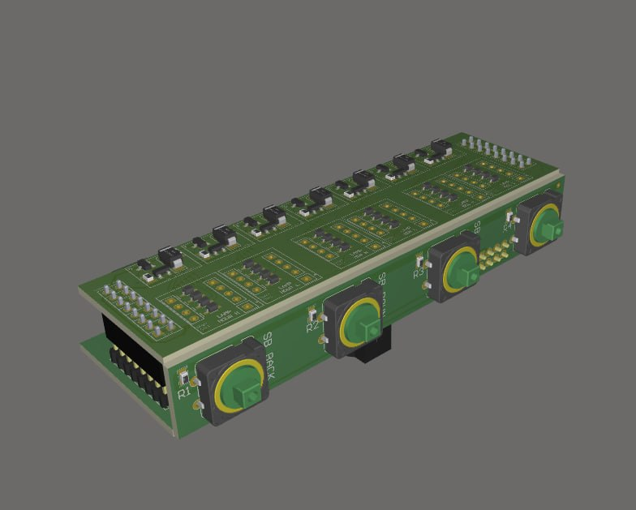
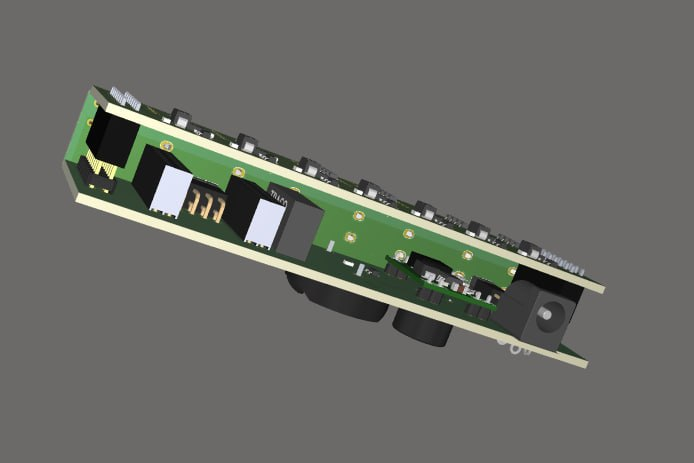
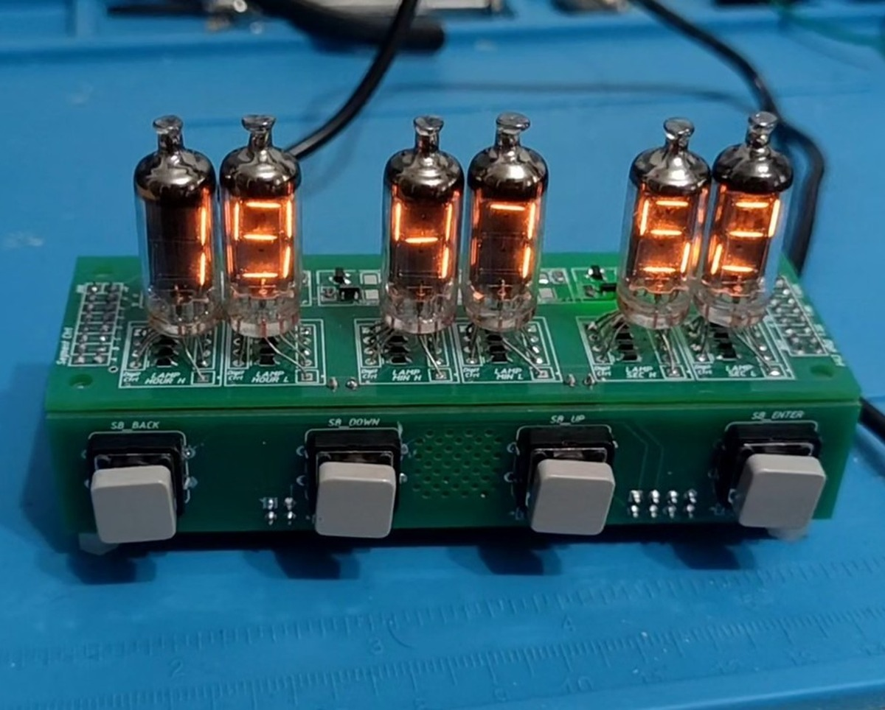
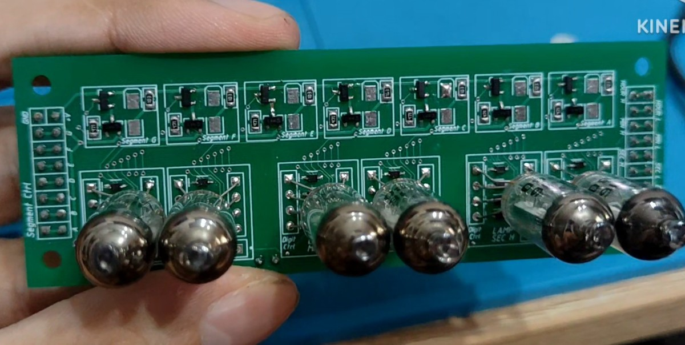
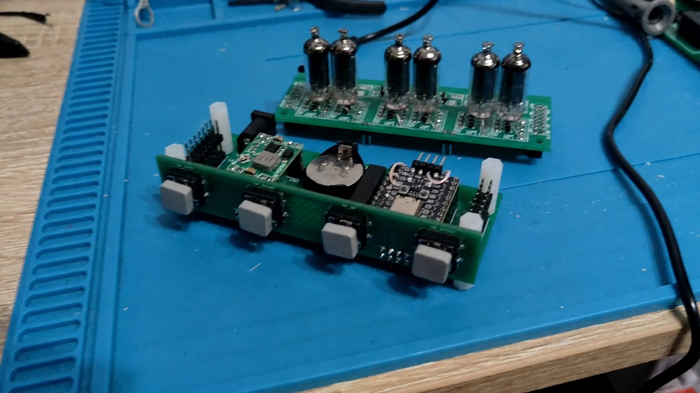
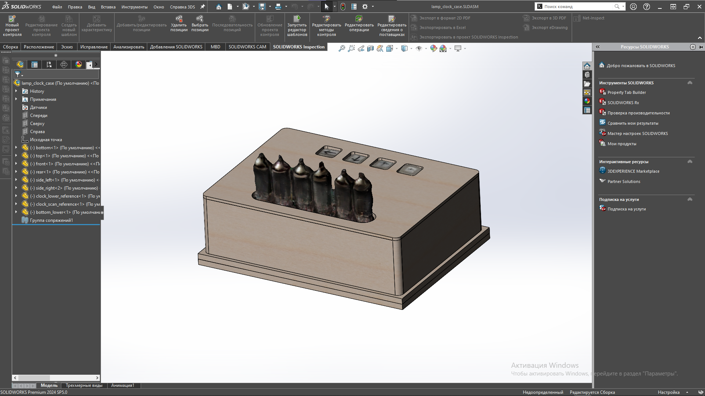
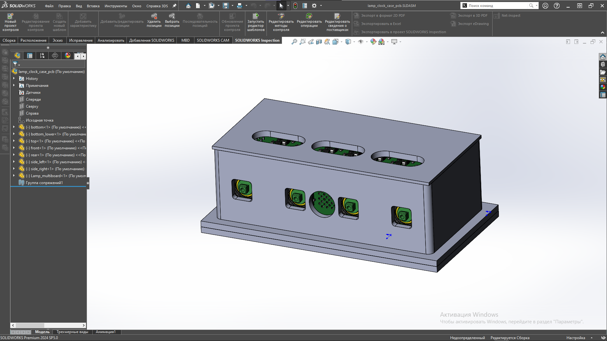

# LampsAltium

Altium-проект плат для часов на ламповых семисегментных индикаторах.

Это аппаратная часть моего проекта ламповых часов. В репозитории лежат схемы, платы, библиотеки компонентов, multiboard-сборка, Gerber-файлы для изготовления и модели корпуса.

## Что входит в проект

- `Lamp_board` - плата с ламповыми семисегментными индикаторами и ключами управления сегментами.
- `Lamp_buttons` - плата с кнопками для управления часами.
- `Lamp_motherboard` - основная плата устройства с микроконтроллером, питанием, разъемами и обвязкой.
- `Multiboard` - сборка нескольких плат в одном устройстве.
- `lamp_box` - модели простого фанерного корпуса для макетной и PCB-версий часов, а также STL-файлы и данные для изготовления деталей.
- `output` - Gerber-файлы и файлы сверловки для изготовления плат.

## Видеодемонстрация

[▶ Смотреть видеодемонстрацию часов на Яндекс Диске](https://disk.yandex.ru/d/FJQ9Txn4kVEkkw)

## Общий вид 3D-модели

  
   <em>Рисунок 1. Верхний ракурс multiboard-сборки печатных плат.</em>

  
   <em>Рисунок 2. Нижний ракурс multiboard-сборки печатных плат.</em>

## Собранные платы

*Шесть ламповых индикаторов в работе: отображение часов, минут и секунд.*

*Плата индикации с шестью лампами и дискретными каскадами управления сегментами.*

*Плата индикации и плата управления перед соединением.*

## Корпус

Помимо печатных плат был спроектирован простой корпус из фанеры в двух вариантах: для ранней макетной сборки часов и для окончательной сборки на разработанных PCB. Исходные модели SolidWorks, отдельные детали и экспортированные STL-файлы находятся в каталогах `lamp_box/prototype` и `lamp_box/pcb`.

  
   <em>Рисунок 3. Корпус для макетной версии часов, модель SolidWorks.</em>

  
   <em>Рисунок 4. Корпус для PCB-версии часов, модель SolidWorks.</em>

Детали корпуса были выфрезерованы на ЧПУ, а для подготовки управляющих данных использовалась собственная программа GerberCNC - утилита, собранная из Candle, FlatCAM и KiriMoto для построения траекторий фрезеровки по исходным данным проекта.

### Реальная сборка PCB-версии

  
   <em>Рисунок 5. Собранные часы в необработанном фанерном корпусе, вид спереди.</em>

  
   <em>Рисунок 6. Вид корпуса сзади и подключение питания.</em>

  
   <em>Рисунок 7. Внутренняя компоновка плат при снятой верхней панели.</em>

## Что было сделано

- Разработана схемотехника плат для часов.
- Разведены платы в Altium Designer.
- Подготовлена multiboard-сборка для проверки компоновки устройства.
- Подготовлены Gerber-файлы для изготовления.
- Спроектированы корпуса для макетной и PCB-версий часов.
- Детали корпуса изготовлены фрезеровкой на ЧПУ.
- Платы используются в составе законченного проекта ламповых часов.

## Особенности

- Индикаторы управляются дискретной логикой на транзисторах и простых компонентах, без специализированных драйверов.
- Конструкция разделена на несколько плат: индикация, кнопки и основная плата.
- В проекте учитывалась реальная сборка устройства: разъемы, механическое расположение плат, кнопки и доступ к органам управления.

## Связанный проект

Прошивка и демонстрация работы часов находятся в отдельном проекте:

- [lamp](https://github.com/Coal56AB/lamp)
